Markdown
# BÁO CÁO BÀI TẬP / ĐỒ ÁN

## THÔNG TIN SINH VIÊN
- **Họ và tên:** Nguyễn Hải Nam
- **Mã số sinh viên:** 24810310617
- **Lớp:** D19CNPM3
- **Tên môn học:** Lập trình C# / Windows Forms
- **Tên bài tập:** [Bài 3: Quản lý danh mục Vật tư / Linh kiện (Item List Manager)]

---

## KẾT QUẢ THỰC HÀNH

### 1. Ảnh màn hình Giao diện chính
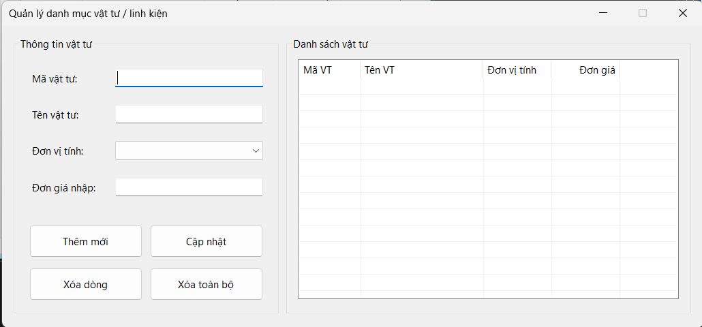

### 2. Ảnh màn hình Chức năng thực thi / Kết quả
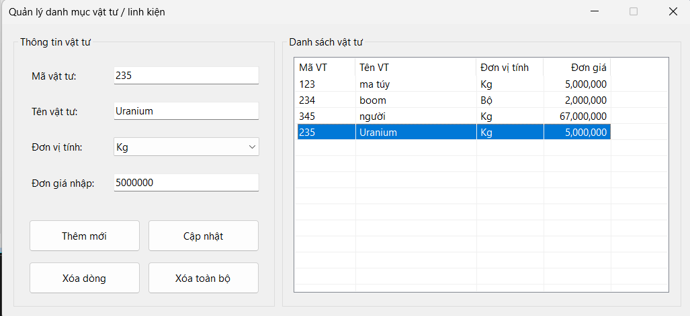
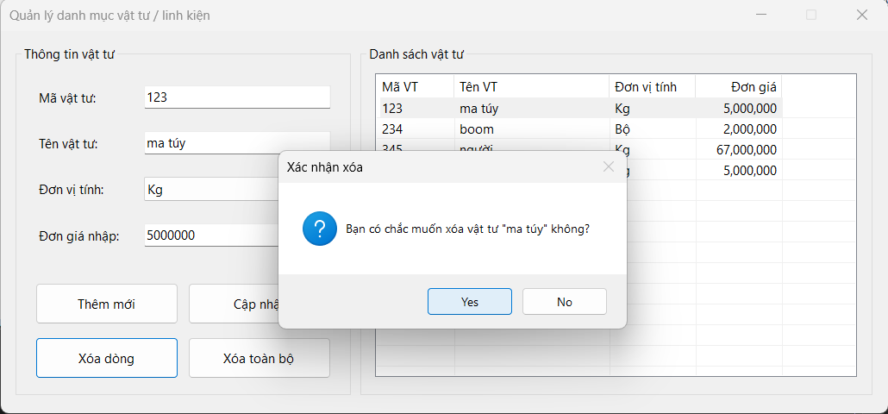
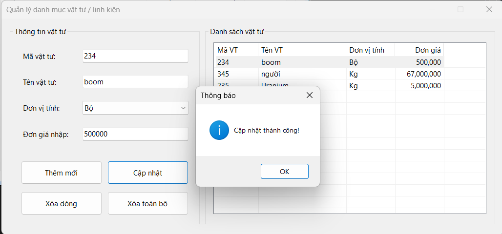
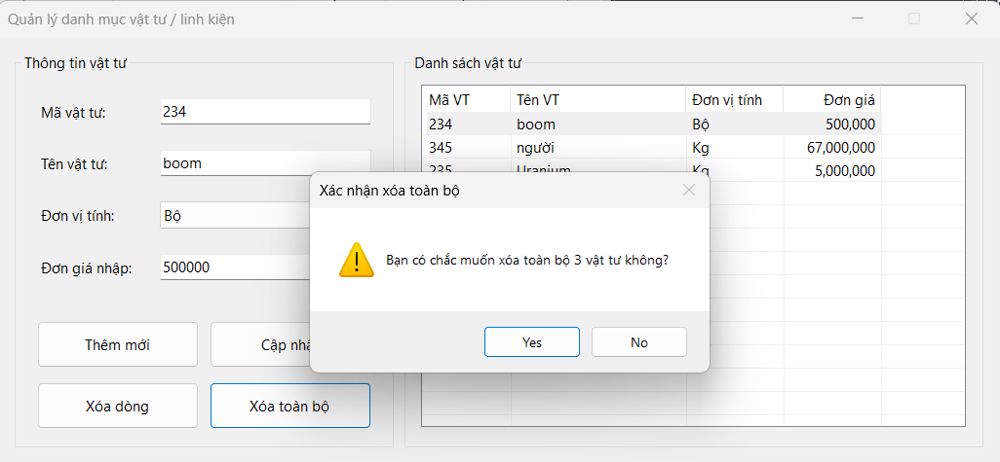

### 3. Ảnh màn hình Kiểm tra lỗi (Validation)

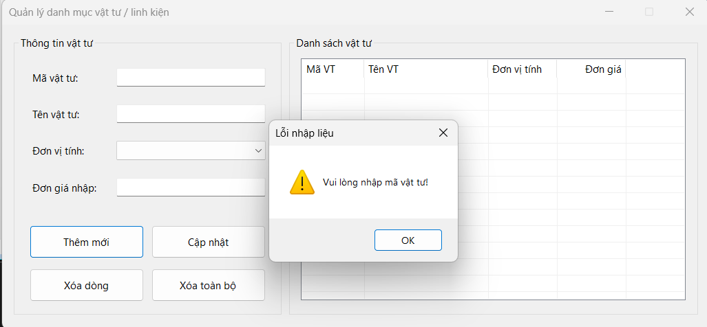
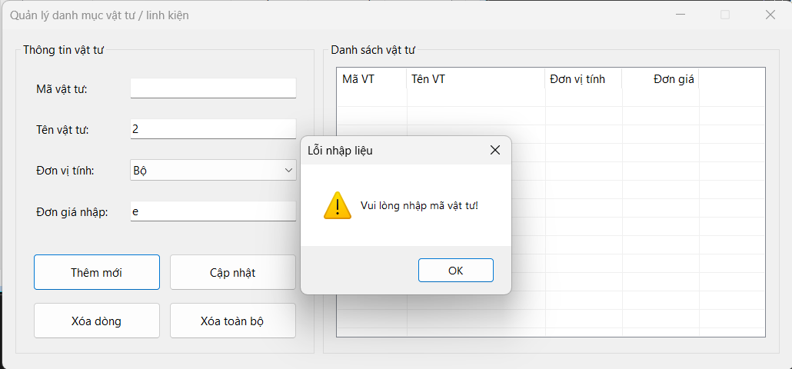
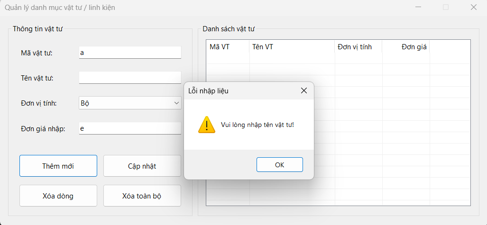
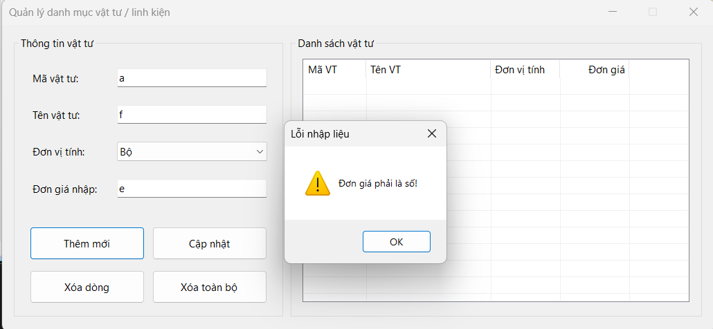
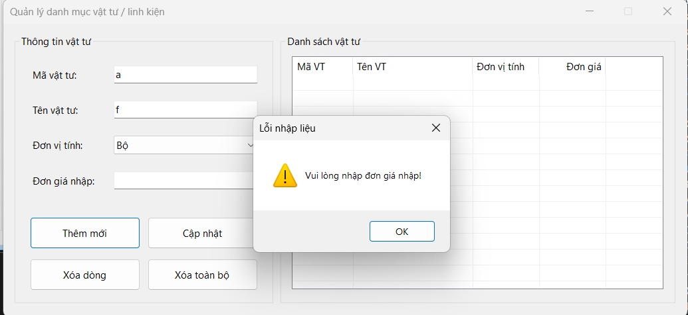
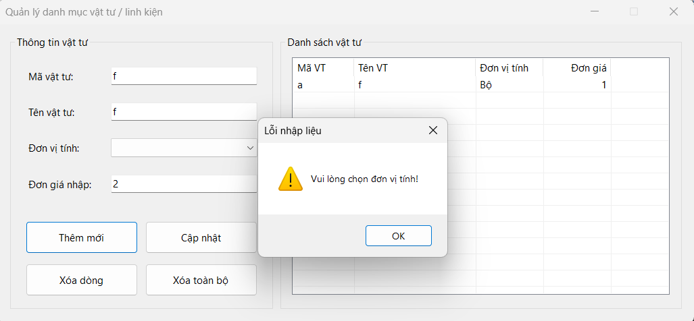
